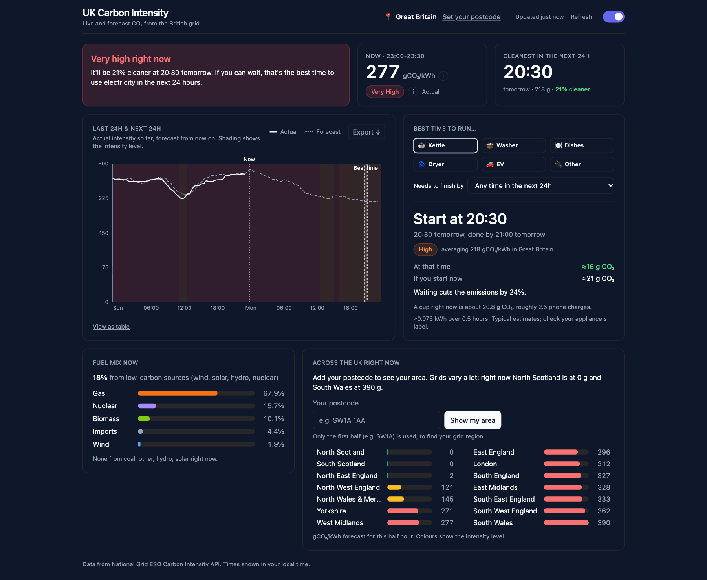
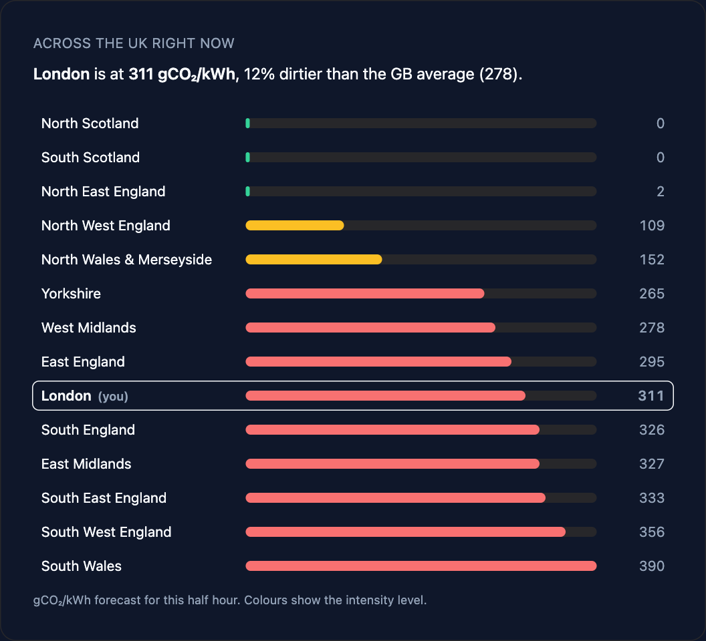
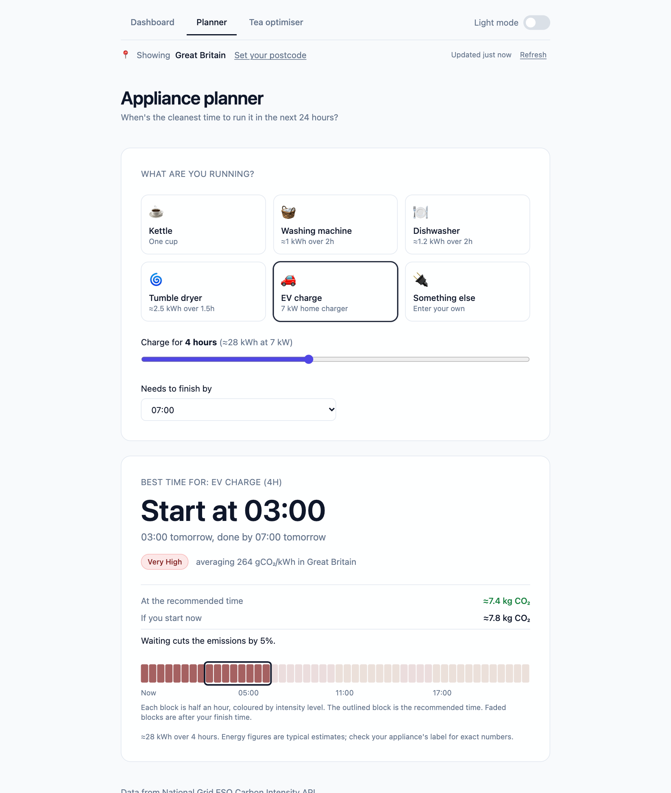
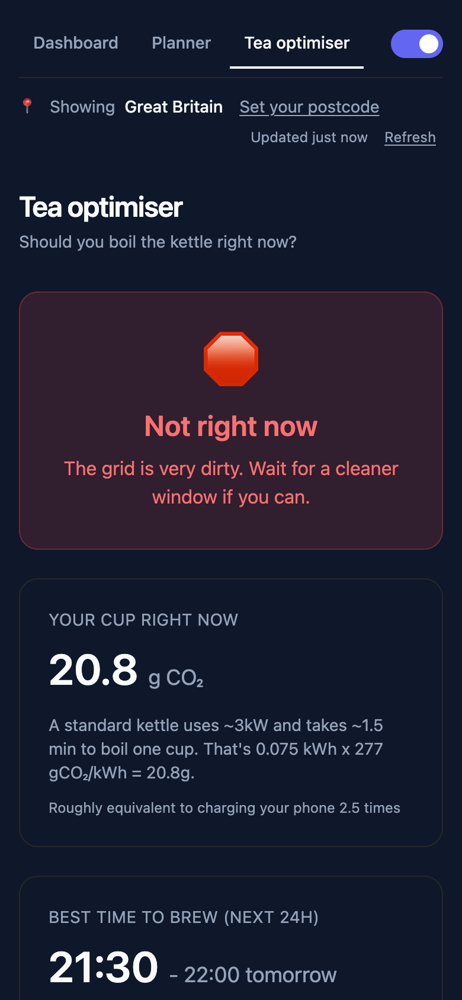
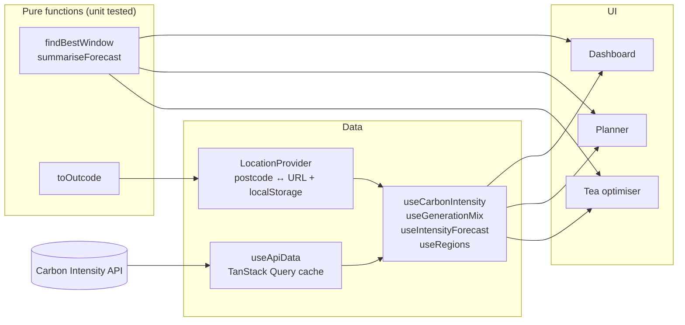

# UK Carbon Intensity Dashboard

[](https://github.com/myaferguson/mya-carbon-dashboard/actions/workflows/ci.yml)

How clean is the electricity where you live right now, and when should you run the washing machine, charge the car or boil the kettle?

**Live**: [mya-carbon-dashboard.vercel.app](https://mya-carbon-dashboard.vercel.app/)



## What it does

- **Tells you what to do, in one sentence.** "Very high right now · 277 gCO₂/kWh. It'll be 22% cleaner at 21:30 tomorrow."
- **Shows your area.** Enter a postcode to switch every figure to your grid region, and see how it compares with the other 13 regions and the GB average. The postcode is remembered and kept in the URL, so you can share a link.
- **Plans your appliances.** Choose a kettle, washing machine, dishwasher, tumble dryer, EV charge or your own appliance, and optionally a "finish by" time. The planner finds the cleanest run of consecutive half hours and tells you how much CO₂ waiting saves.
- **Shows the trend.** A 48-hour chart: actual intensity for the last 24 hours and the forecast for the next 24, with a "Now" line and shading by intensity level. Export it as PNG or CSV, or read it as a table.
- **Explains the numbers.** ⓘ popovers explain gCO₂/kWh and the five intensity levels in plain English.
- **Tea optimiser.** The original, slightly silly page that started it all: should you boil the kettle right now?

| Your area | Appliance planner | Mobile |
|---|---|---|
|  |  |  |

All data comes from the National Grid ESO's free [Carbon Intensity API](https://carbonintensity.org.uk/).

## Why

A side project to build a small, real-world data dashboard using a modern frontend stack — and to put my chemical engineering interest in decarbonisation to practical use.

## How it's built



- **React 19**, **TypeScript**, **Vite** and **Tailwind CSS v4**
- **TanStack Query** for fetching, caching and refreshing data
- **Recharts** for the trend and fuel-mix charts. The planner's timeline is a hand-built SVG.
- **Headless UI** for the accessible popovers, radio group, menu and switch
- Deployed on **Vercel**. Every push to `main` deploys.

### Decisions worth explaining

**One data hook, many endpoints.** Every request goes through `useApiData`, which uses TanStack Query underneath. The three data hooks return the same shapes whether they're showing national or regional data, so pages and components don't know or care which one they've got. Switching to your postcode is a context change, not a rewrite.

**Shared, self-refreshing data.** Each URL is fetched once and shared across pages, so moving from Dashboard to Planner makes no new requests. Forecast URLs are rounded to the half hour, matching how often the API publishes. They roll over automatically when the next half hour starts, and keep showing the previous data until the new data arrives, so nothing flickers. Data also refreshes every 30 minutes and when you come back to the tab.

**The planner is a sliding-window search.** `findBestWindow(periods, slots, { now, deadline })` checks every run of `slots` consecutive half hours that hasn't finished yet and ends before the deadline, and picks the one with the lowest average. If the data has a gap, the run is skipped, and ties go to the earliest start. It's a small pure function with its own tests, and the Tea optimiser and dashboard summary use it too.

**Regional data is forecast-only.** The regional API has no actual readings, so for a postcode the chart changes from "last 24h & next 24h" to "next 48h" and says why. The current figure is labelled "Forecast only". Unknown postcodes come back from the API in two different ways (a 400 error, or a 200 with no data). Both are handled, and the page shows one clear message.

**Everything you choose is shareable.** Postcode, appliance, charge length and finish time all live in the URL, for example `/planner?postcode=SW1A&appliance=ev&hours=4&by=07:00`.

**Each page loads only what it needs.** Each page is lazy-loaded, and on the Dashboard the two charts load after the summary text. The charting library is the largest dependency, so Planner and Tea visitors never download it, and the summary appears before the charts are ready.

## Quality

| | |
|---|---|
| **Unit and component tests** | 87 tests (Vitest + Testing Library): the planner, postcode parsing, regional data mapping, URL and localStorage state, the hooks, and key components |
| **End-to-end tests** | 15 Playwright tests against a mocked API with a frozen clock, so every expected number and time is fixed: summary, postcode flow, unknown postcode, theme persistence, EV planning with a deadline, regional planning, mobile layout |
| **Accessibility** | axe (WCAG 2 A/AA + best practice) reports **0 violations** on every page in light and dark mode, checked in CI. Charts have text summaries and a table view, every control has a visible focus ring, there's a skip link, and animations respect reduced-motion settings. |
| **Lighthouse** (production build) | Desktop: **100 / 100 / 100 / 100** on every page. Mobile: Performance 87–98, Accessibility 100, Best practices 100, SEO 100. |
| **CI** | GitHub Actions runs lint, unit tests, build and end-to-end tests on every pull request |

## Running locally

```bash
npm install
npm run dev        # http://localhost:5173
npm test           # unit and component tests
npm run test:e2e   # end-to-end tests (uses your installed Chrome)
npm run lint
npm run build
```

## Project layout

```
src/
  pages/        Dashboard, Planner, Tea optimiser (each lazy-loaded)
  components/   Cards, charts, timeline, postcode form, popovers
  hooks/        useApiData + one hook per data source, useNow
  context/      LocationProvider (postcode ↔ URL + localStorage)
  utils/        Pure logic: planner, postcode, regional mapping, formatting
tests/          Vitest unit and component tests
e2e/            Playwright tests and the mocked API
```

## What's next

- 24-hour fuel-mix history as a stacked chart (`/generation/{from}/pt24h`)
- "Why is it high right now?": each fuel's share × its CO₂ per kWh (`/intensity/factors`)
- A weekly heatmap of the cleanest times
- A map of the regions

## Author

[Mya Ferguson](https://github.com/myaferguson)
